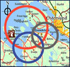

# SaTScan — Experimental Computational Optimization Fork

> This repository contains modifications to the SaTScan computational engine aimed at reducing execution time for purely spatial and space-time analyses under the discrete Poisson model for high-rate clusters.

## About this fork

The project builds on the original SaTScan source code, retaining its general scan-statistic framework while introducing computational changes to neighbor construction, observed-data scanning, and Monte Carlo evaluation. The work focuses on circular and elliptic scanning configurations. The changes are intended to preserve candidate scanning windows and statistical calculations within the tested analysis settings; equivalence should **not** be assumed for all SaTScan models or settings.

### Tested scope

Results were compared with unmodified SaTScan v10.3.3 only for:

- discrete Poisson model, high-rate scanning, one data set, no relative-risk threshold;
- purely spatial analyses (circular and elliptic);
- retrospective space-time analyses (circular and elliptic) without time-stratified adjustment and without inclusion of purely spatial or purely temporal clusters.

### Main modifications

| Area | Modification | Active in | Tested |
| --- | --- | --- | --- |
| Neighbor construction | Parallel construction across centers/shapes (up to 8 workers, fixed in code); worker-local scratch state | All analyses using circular or elliptic windows | Tested scope only |
| Elliptic neighbor storage | Contiguous index storage, with an offset per scanning center | All elliptic analyses | Tested scope only |
| Observed-data scan | Parallel evaluation of scanning centers (24 workers, fixed in code) with worker-local state and synchronized result insertion | Purely spatial and space-time analyses, **all probability models** | Tested scope only |
| Observed-data case gate | Skips temporal-window evaluation for spatial expansions that add no observed cases | Configurations meeting the case-gate conditions below | Tested scope only |
| Monte Carlo case gate | Skips candidate-window evaluation for expansions that add no simulated cases; stops accumulating after the last neighbor containing cases | Configurations meeting the case-gate conditions below | Tested scope only |
| Monte Carlo window-level case gate | When an added location contains cases, evaluates only the temporal windows whose case count changed | Configurations meeting the case-gate conditions below | Tested scope only |
| Monte Carlo batching | Processes 4 simulated datasets per spatial-neighbor traversal, sharing expected-count accumulation; case counts, window evaluations and maximum LLR remain separate per replication | Configurations meeting the case-gate conditions below | Tested scope only |
| Space-time expected counts | Location-oriented (location-major) copy of expected counts | Space-time **Monte Carlo** only (the observed-data scan uses the original layout) | Tested scope only |
| Temporal evaluation | Cached temporal-window bounds | Space-time Monte Carlo | Tested scope only |
| Purely spatial Monte Carlo | Direct (non-virtual) measure-list updates when the minimum-measure list is used | Purely spatial Monte Carlo | Tested scope only |

**Case-gate conditions** (checked automatically at run time; identical for the observed-data and Monte Carlo gates from v1.1.1): retrospective space-time analysis; discrete Poisson model; high-rate scanning only; one data set; no relative-risk threshold; standard temporal-window evaluation (no time-stratified adjustment); no inclusion of purely spatial or purely temporal clusters; non-negative expected-count contributions in every time period. If any condition fails, the gates and batching are disabled and all candidate windows are evaluated as in the original implementation.

The case gates do **not** eliminate neighbor traversal. Their correctness argument relies on these assumptions; see the supplementary methods before applying them to other models.

### Build configuration

The case gates and batching are compile-time options:

```
STMC_CASE_GATE_MODE=2;STMC_MC_BATCH2;STMC_WINDOW_GATE
```

They are set only in the Visual Studio **Release|x64** configuration of `batch_application/SaTScan.vcxproj`. Other Visual Studio configurations, the shared library / GUI projects and the Linux `Makefile` build **without** the case gates and batching (the parallel and memory-layout changes are always compiled in). All modules must be compiled with the same set of options. Worker counts are fixed in the source code and can only be changed by recompiling.

`STMC_CASE_GATE_MODE=1` builds a verification mode that runs the complete original evaluation and reports, in the `PROFILE_STMC_CASEGATE` line, whether any skipped evaluation would have changed a result (`probe_updates`).

### Evaluation scope

Research benchmarks covered purely spatial elliptic scanning (999 Monte Carlo replications), circular space-time scanning (999), and elliptic space-time scanning (9, 99, and 999). The original and modified implementations were evaluated under matched analysis settings and replication counts, including elliptic space-time scanning with 999 replications.

Verification examined the observed maximum log-likelihood ratio (LLR), reported cluster statistics, spatial membership, temporal intervals, and scanning-window geometry. In the elliptic space-time analyses, all 17 reference clusters were recovered with matching spatial membership and geometry. At 999 replications, the modified implementation reported one additional **non-significant** cluster; thus the complete reported cluster sets were not identical. Matching replication counts permits Monte Carlo comparisons but does not, by itself, establish identical p-values or randomization sequences.

The benchmarks used 8 workers for circular neighbor construction, 8 for elliptic neighbor construction, and 24 for observed-data scanning. Circular and elliptic space-time Monte Carlo processing used a batch size of 4 simulated datasets per shared traversal. These values are fixed in the source code; they describe the tested benchmarks, not tuned or guaranteed optimal settings for other hardware.

### Status and limitations

- This is an experimental research fork derived from the original SaTScan source code, **not an official SaTScan release**. Independently verify results before operational or scientific use.
- Analyses outside the tested scope still run the modified parallel neighbor construction and parallel observed-data scan. Their results have not been compared with the original implementation.
- The case-gate justification does not cover other probability models, low-rate or simultaneous high/low scanning, prospective analyses, or every cluster-reporting configuration.
- The 17 elliptic space-time reference clusters were recovered, but one additional non-significant cluster was reported by the modified MC999 analysis; do not interpret the complete output sets as identical.
- Runtimes and speedups depend on the hardware, input data, compiler/build settings, and scan parameters.
- Build instructions below are preserved from the upstream documentation and may require adaptation for this fork.

### Version history

- **v1.1.1:** The observed-data case gate uses the same eligibility conditions as the Monte Carlo gate (adds: exact space-time analysis class, retrospective analysis, standard temporal-window evaluation, non-negative expected counts). Both gates are now restricted to retrospective space-time analyses. Outputs for configurations within the tested scope are unchanged. README and architecture notes corrected (Monte Carlo batch size is 4).
- **v1.1.0:** Computational optimization research release.

### Documentation

- [Architecture and optimization notes](architectural.md)
- [Original SaTScan source code](https://github.com/scanstatistics/satscan)
- [Official SaTScan website](https://www.satscan.org/)
---

## Original SaTScan documentation

The documentation below is retained from the [original SaTScan repository](https://github.com/scanstatistics/satscan). The original source code and documentation are attributed to their respective authors. The modifications described above are part of this experimental research fork and are not an official SaTScan release.

 SaTScan - Software for the spatial, temporal, and space-time scan statistics
====
SaTScan™ is a free software that analyzes spatial, temporal and space-time data using the spatial, temporal, or space-time scan statistics. It is designed for any of the following interrelated purposes:

-   Perform geographical surveillance of disease, to detect spatial or space-time disease clusters, and to see if they are statistically significant.
-  Test whether a disease is randomly distributed over space, over time or over space and time.
-   Evaluate the statistical significance of disease cluster alarms.
-   Perform repeated time-periodic disease surveillance for early detection of disease outbreaks.

The software may also be used for similar problems in other fields such as archaeology, astronomy, botany, criminology, ecology, economics, engineering, forestry, genetics, geography, geology, history, neurology or zoology.

You can find more information about SaTScan on the <a target="_blank" href="https://www.satscan.org/">homepage</a> and in the <a target="_blank" href="https://www.satscan.org/cgi-bin/satscan/register.pl/SaTScan_Users_Guide.pdf?todo=process_userguide_download">user guide</a>. Prebuilt installers for Windows, Linux, and macOS are <a target="_blank" href="https://www.satscan.org/download.html">also available</a>.


License
-------

SaTScan source code is released under the following terms:

Copyright &copy; 2023 [Martin Kulldorff](mailto:kulldorff@satscan.org)

Without warranty of any kind, permission is hereby granted to any person to copy, publish, distribute, and share all or portions of this open-source SaTScan Software; to use, modify, merge, adapt, and build upon the Software; and to publish and distribute derivates of the Software, so long as (i) attribution is given to the creator, (ii) the above copyright and this permission notice is included with all copies of the Software and portions of the Software, and (iii) any published, distributed or shared modification, adaption or derivative of the Software must be shared under identical licensing and permission terms.

Building Native Binaries
-----------
The following are the prerequisites for compiling the command-line C/C++ application and dynamic-link library (.dll) / shared objects file (.so) / java native interface library (.jnilib). 
### General Prerequisites
- Boost C++ Libraries, current version <a target="_blank" href="https://www.boost.org/users/history/version_1_81_0.html">1.81.0</a> (libraries do not need to be build).
- Java Development Kit 17
### Windows
#### Prerequisites
- Visual Studio 2022
- Microsoft Windows SDK v10.0 (or newer)

The Visual Studio Solution references relative paths to the Boost library and JDK C++ headers. These can be either copied into the repository directory or a symbolic link can be created using mklink to reference shared resources:
- boost\boost_1_81_0\
 ex. mklink /d boost *"C:\Users\joeuser\boost"*
- jdk\include\
  ex. mklink /d jdk *"C:\Program Files\Eclipse Adoptium\jdk-17.0.9.9-hotspot"*
### Linux
#### Prerequisites
- GCC (compiled with 4.8.5 or 8.5.0 currently)

The Linux binaries are built through the [Linux build_binaries](scripts/linux/build_binaries) shell script.
### macOS
#### Prerequisites
- Apple clang 17

The macOS binaries are built through the [macOS build_binaries](scripts/mac/build_binaries) shell script.

Building Java User Interface
-----------
The Java user interface provides the graphical front-end to the native library file written in C/C++ (.dll/.so/.jnilib).
### Prerequisites
- NetBeans (<a target="_blank" href="https://netbeans.apache.org/">Version 19</a>)
- Java Development Kit 17

Architecture
-----------
See the [architecture document](architectural.md) for an overview of the source code design.
