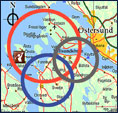

# SaTScan — Experimental Computational Optimization Fork

> This repository contains modifications to the SaTScan computational engine aimed at reducing execution time for purely spatial and space-time analyses under discrete Poisson model for high-rate clusters.
## About this fork

The project builds on the original SaTScan source code, retaining its general scan-statistic framework while introducing computational changes to neighbor construction, observed-data scanning, and Monte Carlo evaluation. The work focuses on circular and elliptic scanning configurations. The changes are intended to preserve candidate scanning windows and statistical calculations within the supported, tested analysis settings; equivalence should **not** be assumed for all SaTScan models or settings.

### Main modifications

| Area | Modification | Applicability / qualification |
| --- | --- | --- |
| Neighbor construction | Parallel work across centers/shapes; worker-local scratch state | Circular and elliptic scans |
| Elliptic neighbor storage | Contiguous index storage to reduce allocation overhead | Elliptic scans |
| Observed-data scan | Parallel evaluation with worker-local state and synchronized results | Tested spatial and space-time paths |
| Space-time expected counts | Location-oriented memory access layout | Space-time scans |
| Temporal evaluation | Cache reusable time-window bounds | Space-time scans |
| Exact case gate | Avoid likelihood evaluation for eligible zero-case spatial expansions | High-rate, single-dataset Poisson space-time settings under documented conditions |
| Monte Carlo batching | Process up to eight simulated datasets together, sharing invariant neighbor traversal and expected-count accumulation | Tested circular and elliptic space-time paths |

The case gate does **not** eliminate neighbor traversal. Its correctness argument has specific assumptions; see the project supplementary methods or implementation notes before applying it to other models.

### Evaluation scope

Research benchmarks covered purely spatial elliptic scanning (999 Monte Carlo replications), circular space-time scanning (999), and elliptic space-time scanning (9, 99, and 999). The original and modified implementations were evaluated under matched analysis settings and replication counts, including elliptic space-time scanning with 999 replications.

Verification examined the observed maximum log-likelihood ratio (LLR), reported cluster statistics, spatial membership, temporal intervals, and scanning-window geometry. In the elliptic space-time analyses, all 17 reference clusters were recovered with matching spatial membership and geometry. At 999 replications, the modified implementation reported one additional **non-significant** cluster; thus the complete reported cluster sets were not identical. Matching replication counts permits Monte Carlo comparisons but does not, by itself, establish identical p-values or randomization sequences.

This configuration deployed 8 workers for circular neighbor construction, 8 for elliptic neighbor construction, and 24 for observed-data scanning. Circular and elliptic space-time Monte Carlo processing used a batch size of 8 simulated datasets per shared traversal. These settings describe the tested benchmarks, not universal defaults or guaranteed optimal configurations. Neighbor-construction workers, observed-scan workers, and Monte Carlo batch size control distinct stages of computation.

### Status and limitations

- This is an experimental research fork derived from the original SaTScan source code, **not an official SaTScan release**. Independently verify results before operational or scientific use.
- Computational agreement was evaluated for the stated discrete Poisson, high-rate configurations. These tests and the case-gate justification do not establish equivalence for all probability models, low-rate or simultaneous high/low scanning, or every cluster-reporting configuration.
- The 17 elliptic space-time reference clusters were recovered, but one additional non-significant cluster was reported by the modified MC999 analysis; do not interpret the complete output sets as identical.
- Runtimes and speedups depend on the hardware, input data, compiler/build settings, and scan parameters. Worker counts and batch size are benchmark-specific settings.
- Build instructions below are preserved from the upstream documentation and may require adaptation for this fork.

### Documentation

- [Architecture and optimization notes](architectural.md)
- [Official SaTScan website](https://www.satscan.org/)

---

## Original SaTScan documentation (Source preserved)

 SaTScan - Software for the spatial, temporal, and space-time scan statistics
====
SaTScan™ is a free software that analyzes spatial, temporal and space-time data using the spatial, temporal, or space-time scan statistics. It is designed for any of the following interrelated purposes:

-   Perform geographical surveillance of disease, to detect spatial or space-time disease clusters, and to see if they are statistically significant.
-  Test whether a disease is randomly distributed over space, over time or over space and time.
-   Evaluate the statistical significance of disease cluster alarms.
-   Perform repeated time-periodic disease surveillance for early detection of disease outbreaks.

The software may also be used for similar problems in other fields such as archaeology, astronomy, botany, criminology, ecology, economics, engineering, forestry, genetics, geography, geology, history, neurology or zoology.

You can find more information about SaTScan on the <a target="_blank" href="https://www.satscan.org/">homepage</a> and in the <a target="_blank" href="https://www.satscan.org/cgi-bin/satscan/register.pl/SaTScan_Users_Guide.pdf?todo=process_userguide_download">user guide</a>. Prebuilt installers for Windows, Linux, and macOS are <a target="_blank" href="https://www.satscan.org/download.html">also available</a>.

License
-------

SaTScan source code is released under the following terms:

Copyright &copy; 2023 [Martin Kulldorff](mailto:kulldorff@satscan.org)

Without warranty of any kind, permission is hereby granted to any person to copy, publish, distribute, and share all or portions of this open-source SaTScan Software; to use, modify, merge, adapt, and build upon the Software; and to publish and distribute derivates of the Software, so long as (i) attribution is given to the creator, (ii) the above copyright and this permission notice is included with all copies of the Software and portions of the Software, and (iii) any published, distributed or shared modification, adaption or derivative of the Software must be shared under identical licensing and permission terms.

Building Native Binaries
-----------
The following are the prerequisites for compiling the command-line C/C++ application and dynamic-link library (.dll) / shared objects file (.so) / java native interface library (.jnilib). 
### General Prerequisites
- Boost C++ Libraries, current version <a target="_blank" href="https://www.boost.org/users/history/version_1_81_0.html">1.81.0</a> (libraries do not need to be build).
- Java Development Kit 17
### Windows
#### Prerequisites
- Visual Studio 2022
- Microsoft Windows SDK v10.0 (or newer)

The Visual Studio Solution references relative paths to the Boost library and JDK C++ headers. These can be either copied into the repository directory or a symbolic link can be created using mklink to reference shared resources:
- boost\boost_1_81_0\
 ex. mklink /d boost *"C:\Users\joeuser\boost"*
- jdk\include\
  ex. mklink /d jdk *"C:\Program Files\Eclipse Adoptium\jdk-17.0.9.9-hotspot"*
### Linux
#### Prerequisites
- GCC (compiled with 4.8.5 or 8.5.0 currently)

The Linux binaries are built through the [Linux build_binaries](scripts/linux/build_binaries) shell script.
### macOS
#### Prerequisites
- Apple clang 17

The macOS binaries are built through the [macOS build_binaries](scripts/mac/build_binaries) shell script.

Building Java User Interface
-----------
The Java user interface provides the graphical front-end to the native library file written in C/C++ (.dll/.so/.jnilib).
### Prerequisites
- NetBeans (<a target="_blank" href="https://netbeans.apache.org/">Version 19</a>)
- Java Development Kit 17

Architecture
-----------
See the [architecture document](architectural.md) for an overview of the source code design.
